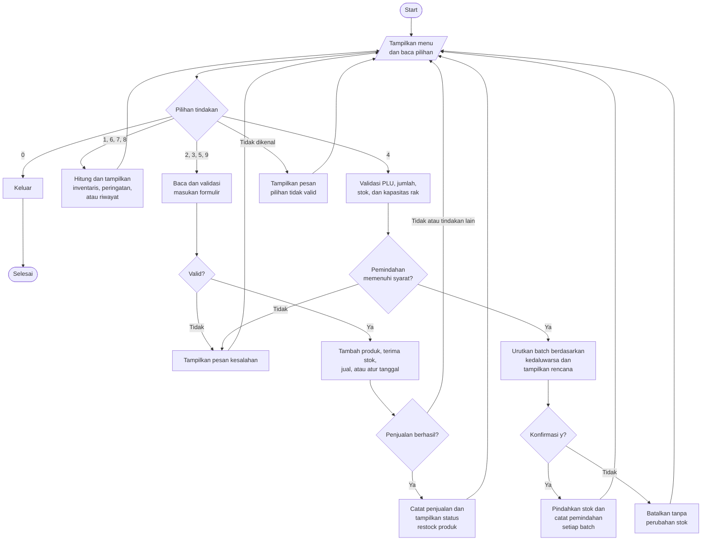

# PantauToko

**Kelompok 2 — Pengantar Pemrograman Komputer**

PantauToko adalah aplikasi berbasis terminal (CLI) Python untuk memantau persediaan toko, mendeteksi stok rak yang rendah, memberikan peringatan kedaluwarsa, serta memindahkan dan menjual stok menggunakan **FEFO (First-Expired, First-Out)**, yaitu mendahulukan barang dengan tanggal kedaluwarsa terdekat.

Toko kecil dapat mengalami rak kosong meskipun stok masih tersedia di gudang. Barang yang lebih baru juga dapat terjual lebih dahulu sementara barang lama mendekati kedaluwarsa. PantauToko memisahkan jumlah stok gudang dan rak serta memprioritaskan batch layak jual yang paling dekat kedaluwarsa. Perubahan stok langsung tercermin selama aplikasi berjalan.

Repositori: [yahfiilham/pantau-toko](https://github.com/yahfiilham/pantau-toko)

## Anggota tim dan kontribusi aktual

Tabel berikut mencatat pekerjaan implementasi yang telah dilakukan. Nama dan username GitHub dikonfirmasi oleh tim; bukti implementasi tersedia dalam riwayat commit. Pembagian aktual ini memperbarui rencana tugas awal.

| Anggota | GitHub | Kontribusi aktual |
|---|---|---|
| Calvin — ketua kelompok | [kevinwu948](https://github.com/kevinwu948) | Model data, peringatan restock F1 beserta pengujiannya, data contoh, integrasi menu utama/F8, perbaikan integrasi, perbaikan bug F3/F5, dan pengujian regresi |
| Yahfi Ilham Maulana | [yahfiilham](https://github.com/yahfiilham) | Penyiapan repositori, tampilan inventaris pada F4, pendaftaran produk F6, penerimaan stok F7, dan pengujian terkait |
| Fahmi Dhiya Ulhaq | [fahmidhiyaulhaq28-lab](https://github.com/fahmidhiyaulhaq28-lab) | Pemindahan stok FEFO F3 beserta pengujiannya |
| Rizka Sahputri | [rizkasahputri](https://github.com/rizkasahputri) | Peringatan kedaluwarsa F2, penjualan F5, dan pembaruan integrasi |
| Maulana Malik Ibrahim | Belum dikonfirmasi | Belum ada kontribusi implementasi yang terverifikasi dalam riwayat `main` yang diperiksa; pekerjaan F1/F5 yang semula direncanakan untuknya diselesaikan oleh Calvin/Rizka |


```bash
git log --all --format="%h | %an | %s"
```

## Fitur dan masukan menu

ID fitur mengikuti dokumen rancangan. **ID fitur berbeda dari nomor menu:** riwayat aktivitas termasuk F4, sedangkan F8 mencakup navigasi menu, validasi masukan, dan tanggal simulasi. Nama menu dalam tanda kurung mengikuti tampilan aplikasi saat ini.

| Menu | Fitur | Masukan | Hasil |
|---:|---|---|---|
| 1 | F4 — Lihat inventaris (`View Inventory`) | Kata kunci nama produk; kosongkan untuk melihat semua | Nama, PLU, harga satuan, lokasi rak, jumlah stok rak/gudang, dan total |
| 2 | F6 — Tambah produk (`Add New Product`) | PLU, nama, lokasi rak, harga, minimum stok rak, kapasitas rak, sesuai urutan tersebut | Mendaftarkan produk tanpa stok awal |
| 3 | F7 — Terima stok (`Receive Stock`) | PLU terdaftar, jumlah berupa bilangan bulat positif, tanggal kedaluwarsa `YYYY-MM-DD` | Membuat batch baru di gudang |
| 4 | F3 — Pemindahan FEFO (`Transfer Warehouse to Shelf`) | PLU, jumlah berupa bilangan bulat positif, lalu `y` atau `n` | Menampilkan rencana FEFO; memindahkan stok dan mencatatnya setelah konfirmasi |
| 5 | F5 — Penjualan (`Sale`) | PLU dan jumlah berupa bilangan bulat positif | Mengurangi stok rak layak jual berdasarkan FEFO, menampilkan subtotal dan rincian batch, mencatat penjualan, lalu mengecek restock produk tersebut |
| 6 | F1 — Peringatan restock (`Check Restock Alerts`) | Tidak ada masukan tambahan | Menampilkan produk dengan stok rak layak jual di bawah minimum, stok gudang tersedia, dan jumlah yang disarankan |
| 7 | F2 — Peringatan kedaluwarsa (`Check Expiry Warnings`) | Tidak ada masukan tambahan | Menampilkan batch berstok yang sudah atau mendekati kedaluwarsa, diurutkan berdasarkan sisa hari |
| 8 | F4 — Riwayat aktivitas (`Activity History`) | Tidak ada masukan tambahan | Menampilkan catatan penjualan/pemindahan dari yang terbaru |
| 9 | F8 — Atur tanggal simulasi (`Set Simulated Date`) | Tanggal `YYYY-MM-DD` | Mengubah tanggal acuan kelayakan stok dan perhitungan kedaluwarsa |
| 0 | F8 — Keluar (`Exit`) | Tidak ada masukan tambahan | Mengakhiri program |

### Validasi dan aturan bisnis

- PLU disimpan sebagai string sehingga angka nol di awal tetap dipertahankan. Masukan pendaftaran dan transaksi menghapus spasi di awal/akhir serta mengubah huruf menjadi kapital. PLU yang didaftarkan harus unik.
- Nama produk dan lokasi rak tidak boleh kosong. Harga dan kapasitas harus berupa bilangan bulat positif; minimum stok harus berupa bilangan bulat tidak negatif dan tidak melebihi kapasitas.
- Stok yang diterima masuk ke **batch gudang baru**, termasuk jika sudah ada batch dengan tanggal kedaluwarsa sama. Penerimaan barang kedaluwarsa ditolak.
- Jumlah pemindahan harus sesuai dengan stok gudang layak jual dan ruang fisik rak yang tersedia. Barang kedaluwarsa yang masih berada di rak tetap dihitung sebagai pemakai kapasitas.
- Penjualan hanya menggunakan stok **rak** yang layak jual. Stok gudang tidak dapat langsung dijual. Jumlah tidak valid dan penjualan melebihi stok ditolak.
- FEFO melewati batch kedaluwarsa dan mengambil batch dengan tanggal kedaluwarsa lebih awal terlebih dahulu. Batch yang kedaluwarsa **hari ini masih dianggap layak jual**.
- Status kedaluwarsa adalah `EXPIRED` jika sisa hari kurang dari 0, `EXPIRING_SOON` jika 0–30 hari, dan `SAFE` jika lebih dari 30 hari. Batch kosong tidak ditampilkan; menu 7 hanya menampilkan peringatan sehingga batch SAFE tidak muncul.
- Pemindahan yang valid memerlukan konfirmasi `y`, tanpa membedakan huruf besar/kecil; masukan konfirmasi lainnya membatalkan pemindahan. Masukan formulir yang tidak valid umumnya mengembalikan pengguna ke menu utama agar dapat mencoba lagi.
- ID penjualan dan pemindahan menggunakan UUID untuk membedakan transaksi yang dibuat dalam detik yang sama.

## Cara menjalankan aplikasi

Aplikasi hanya menggunakan **pustaka standar Python**. `pytest` diperlukan untuk menjalankan pengujian. Lingkungan yang telah diverifikasi adalah Windows 11, Python 3.14.0, dan pytest 9.0.3.

Setelah Python dan Git tersedia, jalankan:

```bash
git clone https://github.com/yahfiilham/pantau-toko.git
cd pantau-toko
python main.py
```

Jika perintah Python pada sistem bernama `python3`, gunakan `python3` sebagai pengganti `python`. Jalankan perintah dari folder utama repositori. Aplikasi tidak memerlukan database, kredensial API, atau variabel lingkungan.

Setiap kali dijalankan, aplikasi memuat **19 produk contoh dan 35 batch stok** dari `seed_data.py`. Tanggal kedaluwarsanya dihitung relatif terhadap tanggal komputer saat aplikasi dimulai. Seluruh data disimpan di memori: **perubahan hilang setelah keluar**, dan menjalankan ulang aplikasi akan memuat kembali data contoh.

## Skenario demonstrasi yang dapat diulang

Mulai aplikasi dalam sesi baru. Urutan berikut mencakup seluruh fitur F1–F8 menggunakan produk baru dengan tanggal tetap, sehingga hasil produk tersebut tidak bergantung pada tanggal saat aplikasi dimulai.

| Langkah | Menu dan masukan berikutnya secara berurutan | Hasil yang diharapkan |
|---:|---|---|
| 1 | `9` → `2026-10-28` | Tanggal simulasi menjadi 2026-10-28 |
| 2 | `2` → `AUDIT` → `Audit Product` → `Z1` → `1250` → `3` → `10` | Produk terdaftar dengan harga 1250, minimum stok 3, dan kapasitas 10 |
| 3 | `3` → `AUDIT` → `8` → `2026-12-27` | Batch B036: stok gudang 8, stok rak 0 |
| 4 | `3` → `AUDIT` → `4` → `2026-10-28` | Batch B037: stok gudang 4, stok rak 0 |
| 5 | `6` | AUDIT memiliki stok rak 0, stok gudang 12, dan rekomendasi restock 10 |
| 6 | `7` | B037 berstatus EXPIRING_SOON dengan sisa 0 hari dan catatan prioritas pemindahan dari gudang |
| 7 | `4` → `AUDIT` → `8` → `y` | FEFO memindahkan B037 × 4, lalu B036 × 4 |
| 8 | `5` → `AUDIT` → `6` | Penjualan mengambil B037 × 4, lalu B036 × 2; subtotal `Rp7,500`; rekomendasi restock 4 |
| 9 | `1` → `Audit Product` | Stok rak 2, stok gudang 4, total 6 |
| 10 | `8` | Terlihat satu catatan penjualan dan dua catatan pemindahan per batch |
| 11 | `9` → `2026-12-28`, lalu `7` | B036 berstatus EXPIRED; B037 yang kosong tidak ditampilkan |
| 12 | `5` → `AUDIT` → `1` | Penjualan ditolak karena stok rak layak jual 0 |
| 13 | `0` | Aplikasi keluar dengan normal |

Setiap panah berarti menekan Enter setelah memasukkan nilai. Nomor B036/B037 mengasumsikan belum ada penerimaan stok lain dalam sesi tersebut. Produk contoh lain dapat ikut muncul dalam daftar peringatan. Nama produk uji `Audit Product` dan format keluaran `Rp7,500` dipertahankan agar sesuai dengan skenario yang telah dijalankan.

Untuk demonstrasi validasi, gunakan sesi baru:

- `4` → `1019` → `1`: pemindahan ditolak karena rak sudah penuh; konfirmasi tidak diminta.
- `4` → `1001` → `-1`: jumlah pemindahan negatif ditolak.
- `4` → `1001` → `1` → `n`: pemindahan dibatalkan tanpa mengubah stok.
- `3` → `1001` → `1` → `2026-02-30`: tanggal kedaluwarsa yang tidak ada ditolak.
- `5` → `1001` → `6`: penjualan ditolak karena stok rak layak jual awal hanya 5.

Saat menyusun laporan, ambil tangkapan layar terminal yang memperlihatkan masukan dan hasil kasus yang selesai. Hasil yang diharapkan dalam README ini tetap perlu dilengkapi bukti tangkapan layar aplikasi.

## Diagram alur sistem



## Model data dan susunan kode

| Kelas | Fungsi dan atribut utama |
|---|---|
| `Product` | Data master produk: `plu`, `name`, `price`, `shelf_location`, `min_shelf_stock`, `shelf_capacity` |
| `StockBatch` | Satu batch penerimaan: `batch_id`, `plu`, `expiry_date`, `warehouse_qty`, `shelf_qty` |
| `Transfer` | Catatan pemindahan per batch: ID, waktu, PLU, ID batch, jumlah |
| `Sale` | Catatan penjualan: ID, waktu, PLU, jumlah, harga satuan saat transaksi, rincian pengambilan batch |
| `Inventory` | Menyimpan daftar produk, batch, catatan pemindahan/penjualan, tanggal simulasi `today`, serta pencarian produk |

`Inventory` memiliki daftar objek lainnya. Satu produk dapat mempunyai banyak batch yang dihubungkan oleh `plu`. Pemindahan mengubah pembagian stok antara gudang dan rak tanpa mengubah total stok fisik. Penjualan mengurangi total stok fisik sesuai jumlah yang terjual.

| Berkas | Tanggung jawab |
|---|---|
| [main.py](main.py) | Menu utama, pemilihan fitur, tanggal simulasi, dan tampilan peringatan |
| [models.py](models.py), [inventory.py](inventory.py) | Objek data, keadaan bersama di memori, dan pencarian produk |
| [seed_data.py](seed_data.py) | Produk dan batch contoh untuk demonstrasi |
| [f1_get_restock_alerts.py](f1_get_restock_alerts.py) | Perhitungan stok layak jual dan rekomendasi restock |
| [f2_expirywarning.py](f2_expirywarning.py) | Klasifikasi dan pengurutan kedaluwarsa |
| [f3_transfer_fefo.py](f3_transfer_fefo.py) | Validasi, perencanaan, konfirmasi, pelaksanaan, dan pencatatan pemindahan |
| [f4_view_inventory.py](f4_view_inventory.py) | Ringkasan inventaris, pencarian, format tampilan, dan riwayat aktivitas |
| [f5_sale.py](f5_sale.py) | Validasi penjualan, pengurangan stok FEFO, subtotal, dan pencatatan penjualan |
| [f6_add_product.py](f6_add_product.py) | Pendaftaran produk beserta formulirnya |
| [f7_receive_stock.py](f7_receive_stock.py) | Validasi penerimaan, pembuatan batch, dan formulirnya |
| [test/](test/), [pytest.ini](pytest.ini) | Pengujian otomatis dan konfigurasi pytest |

Implementasi menggunakan fungsi fitur yang terpisah dan menerima objek `Inventory`. Rancangan awal mengusulkan seluruh metode bisnis berada di dalam `Inventory`; susunan modular saat ini berbeda, tetapi tetap berbagi model data yang sama. `utils.py` dan `test/testinventory.py` saat ini merupakan berkas kosong dan tidak diperlukan untuk menjalankan aplikasi.

## Konsep pemrograman yang diterapkan

| Persyaratan mata kuliah | Penerapan dalam program |
|---|---|
| Variabel dan tipe data yang sesuai | PLU/nama berupa string, harga/jumlah berupa integer, hasil keberhasilan berupa Boolean, serta nilai `date` dan `datetime` |
| Masukan pengguna dan keluaran program | Formulir `input()` serta menu, tabel, peringatan, dan hasil transaksi melalui `print()` |
| Operator aritmetika | `price * qty`, pengurangan stok gudang, penambahan stok rak, dan selisih tanggal |
| Operator relasional dan logika | `qty <= 0`, `expiry_date >= today`, serta penyaringan batch dengan gabungan kondisi `and`/`or` |
| Percabangan | `if`/`elif`/`else` untuk pemilihan menu, validasi, dan status kedaluwarsa |
| Perulangan | `while True` pada menu utama dan perulangan `for` untuk memeriksa produk, batch, serta riwayat |
| Fungsi | `get_restock_alerts`, `get_expiry_alerts`, `f3_transfer_fefo`, `sell`, dan fungsi menu |
| List | Kumpulan produk/batch, rencana FEFO, catatan transaksi, dan hasil ringkasan |
| Manipulasi string | Normalisasi PLU dengan `.strip().upper()`, pencarian nama dengan `.lower()`, pencocokan bagian string, dan pemformatan keluaran |
| Kelas / OOP — opsional dalam tugas | `Product`, `StockBatch`, `Transfer`, `Sale`, dan `Inventory` |
| Pengujian unit | `unittest.TestCase`, asersi/parametrisasi pytest, serta simulasi masukan konfirmasi dan waktu di folder `test/` |

### Potongan kode untuk dijelaskan saat presentasi

**1. Kelayakan stok dan perulangan — `f1_get_restock_alerts.py`:**

```python
for batch in inventory.batches:
    if batch.plu == plu and batch.expiry_date >= inventory.today:
        total_shelf_stock += batch.shelf_qty
```

Perulangan memilih batch untuk satu produk. Operator logika `and` menggabungkan kecocokan produk dengan syarat tanggal kedaluwarsa, sedangkan `+=` menjumlahkan stok rak yang masih layak jual.

**2. Pengurutan FEFO — `f5_sale.py`:**

```python
valid_batches.sort(key=lambda x: x.expiry_date)
```

Pengurutan berdasarkan tanggal kedaluwarsa menempatkan batch layak jual dengan tanggal terdekat di urutan pertama. Perulangan penjualan berikutnya mengambil nilai terkecil antara stok rak batch dan sisa jumlah yang diminta, sehingga satu penjualan dapat mengambil stok dari beberapa batch.

**3. Perlindungan kapasitas rak — `f3_transfer_fefo.py`:**

```python
stok_rak = sum(b.shelf_qty for b in inv.batches if b.plu == plu)
ruang_rak = max(0, product.shelf_capacity - stok_rak)
if jumlah_minta > ruang_rak:
    return f"GAGAL: Minta {jumlah_minta}, ruang rak hanya {ruang_rak}."
```

Kode ini menjumlahkan stok fisik di rak, menghitung sisa kapasitas, dan menolak pemindahan yang terlalu besar sebelum meminta konfirmasi atau mengubah jumlah stok.

## Pengujian otomatis

Pasang alat pengujian dan jalankan seluruh pengujian dalam repositori:

```bash
python -m pip install pytest
python -m pytest -q
```

Untuk melihat hasil setiap kasus, gunakan `python -m pytest -v`. `pytest.ini` mengatur jalur impor proyek dan folder `test`. Gunakan pytest agar pengujian berbentuk fungsi dan parametrisasi pytest ikut dijalankan, selain pengujian berbasis unittest.

Pada commit implementasi `858159e`, **47 pengujian dalam repositori lulus** menggunakan Python 3.14.0 / pytest 9.0.3. Jumlah ini mencakup 20 kasus regresi F3/F5 untuk jumlah tidak valid, kapasitas, FEFO, normalisasi, dan keunikan ID transaksi.

Audit tambahan di luar repositori menjalankan **91 pemeriksaan: 54 pemeriksaan fungsi/integrasi dan 37 skenario CLI melalui proses aplikasi asli**, semuanya lulus setelah perbaikan. Skrip audit tersebut belum disertakan dalam repositori, sehingga hasil clone baru menjalankan **47 pengujian**, bukan 138. Kasus tambahan tersebut dapat dimasukkan sebelum pengumpulan, terutama batas kedaluwarsa F2, riwayat F4, penolakan stok kedaluwarsa F5, dan alur masukan/tanggal F8. Hasil lulus berlaku untuk kasus yang telah diuji; seluruh kemungkinan masukan belum tercakup.

## Ruang lingkup dan keterbatasan saat ini

- Penyimpanan permanen, login, pemesanan ke pemasok, pemrosesan pembayaran, retur, laporan keuangan, dan banyak cabang berada di luar ruang lingkup yang disepakati. Subtotal hanya sebagai informasi; tidak ada perhitungan pembayaran atau kembalian.
- Belum ada operasi penghapusan stok kedaluwarsa. Stok tersebut tetap terlihat dalam inventaris dan diblokir dari penjualan/pemindahan.
- Ringkasan inventaris menampilkan jumlah **fisik**, termasuk barang kedaluwarsa. Perhitungan restock menggunakan jumlah **layak jual**. F1 saat ini menghitung rekomendasi ruang berdasarkan stok rak layak jual, sedangkan F3 memeriksa kapasitas fisik; jika barang kedaluwarsa masih berada di rak, rekomendasi dapat melebihi ruang yang diizinkan F3. Kedua perhitungan perlu diselaraskan agar kondisi ini ditangani dengan benar.
- Peringatan F2 saat ini menampilkan ID batch, PLU, sisa hari, jumlah gudang/rak, dan catatan. Nama lokasi rak yang diminta dalam rancangan awal belum ditampilkan pada peringatan tersebut; informasi itu tersedia di menu Lihat Inventaris.
- CLI saat ini mencampurkan label menu berbahasa Inggris dengan masukan/pesan berbahasa Indonesia. Penyelarasan bahasa tampilan masih menjadi perbaikan untuk presentasi.
- Perubahan tanggal simulasi memengaruhi kelayakan stok dan peringatan. Tanggal awal batch contoh dan waktu nyata yang dicatat dalam riwayat transaksi tetap mengikuti pembuatannya.

## Daftar periksa pengumpulan dan presentasi

README ini menyediakan dokumentasi proyek dan bahan panduan pengguna. Tugas juga mewajibkan **laporan PDF** serta presentasi di kelas.

- [x] Kode CLI Python dan konsep pemrograman yang diwajibkan telah diterapkan.
- [x] Repositori publik dan pengujian yang dapat dijalankan tersedia.
- [x] Panduan pengguna, masukan, diagram alur, penjelasan kode, dan ringkasan kontribusi aktual didokumentasikan di sini.
- [ ] Lengkapi laporan PDF akhir: perkenalan/peran anggota, latar belakang masalah, diagram alur, potongan kode beserta penjelasannya, konsep pemrograman, panduan pengguna, dan tangkapan layar kasus yang selesai.
- [ ] Ambil tangkapan layar aplikasi untuk kasus berhasil maupun ditolak; sertakan keterangan dan hasil yang diharapkan/aktual dalam PDF.
- [ ] Cocokkan kontribusi nyata setiap anggota dengan riwayat Git dan jelaskan pengalihan tugas secara akurat.
- [ ] Pastikan proposal sistem telah dikumpulkan; dokumen tugas mencantumkan batas waktu 21 Oktober.
- [ ] Latihan presentasi maksimal 20 menit dengan demonstrasi semua fitur dan penjelasan alur kode, dilanjutkan tanya jawab 5 menit yang dapat diperpanjang 5 menit lagi sesuai aturan presentasi.
- [ ] Siapkan alokasi penilaian antarkelompok dan alasan tertulis untuk kelompok lain sesuai formulir dosen.

Saran pembagian waktu presentasi: latar belakang dan peran anggota 3 menit, demonstrasi fitur 9 menit, diagram alur/kode/konsep 5 menit, pengujian dan keterbatasan 2 menit, serta cadangan 1 menit. Pembagian ini merupakan saran untuk tim.

Rubrik tugas mengalokasikan 25 poin untuk presentasi, sedangkan dokumen aturan presentasi mencantumkan 30 poin. Konfirmasikan bobot yang berlaku kepada dosen. Dokumen tugas juga menyatakan penalti individual 50 poin bagi anggota tanpa kontribusi commit; pastikan penjelasan peran didukung pekerjaan yang benar-benar dilakukan.
