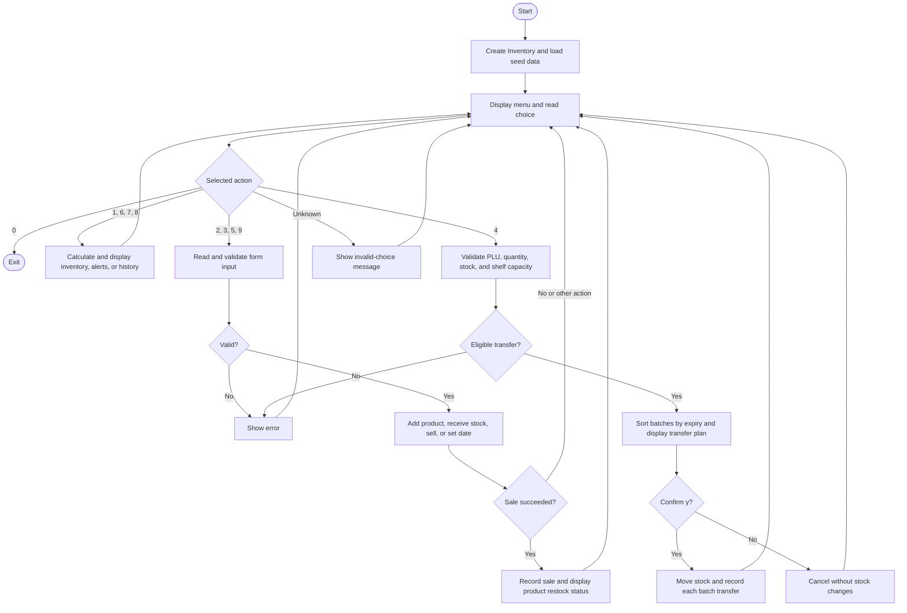

# PantauToko

**Group 2 — Introduction to Computer Programming**

PantauToko is a Python command-line application for monitoring shop inventory, identifying low shelf stock, warning about expiry dates, and moving or selling stock using **FEFO (First-Expired, First-Out)**.

Small shops may have stock in the warehouse while shelves are empty, or sell newer stock while older batches approach expiry. PantauToko keeps warehouse and shelf quantities separately and prioritizes the earliest eligible expiry date. Stock changes are reflected immediately within the running session.

Repository: [yahfiilham/pantau-toko](https://github.com/yahfiilham/pantau-toko)

## Team and actual contributions

The table records completed implementation work, rather than the original proposed allocation. Names and GitHub usernames were confirmed by the team; implementation evidence is available in the commit history.

| Member | GitHub | Actual contribution |
|---|---|---|
| Calvin — team leader | [kevinwu948](https://github.com/kevinwu948) | Data models, F1 restock alerts and tests, seed data, main-menu integration/F8, integration fixes, F3/F5 bug fixes and regression tests |
| Yahfi Ilham Maulana | [yahfiilham](https://github.com/yahfiilham) | Repository setup, inventory view in F4, F6 product registration, F7 stock receiving, and associated tests |
| Fahmi Dhiya Ulhaq | [fahmidhiyaulhaq28-lab](https://github.com/fahmidhiyaulhaq28-lab) | F3 FEFO transfer and its tests |
| Rizka Sahputri | [rizkasahputri](https://github.com/rizkasahputri) | F2 expiry warnings, F5 sales, and integration updates |
| Maulana Malik Ibrahim | Not confirmed | No implementation contribution verified in the current `main` history; the originally planned F1/F5 work was completed by Calvin/Rizka |

Earlier commits by Calvin use the Git author name `Calvinwu948`; the current configured name is `kevinwu948`. These names should be reconciled when reviewing individual contributions. This table does not replace the Git log or the individual explanations required in the final report.

```bash
git log --all --format="%h | %an | %s"
```

## Features and menu inputs

Feature IDs follow the design document. **Feature IDs are not menu numbers:** Activity History belongs to F4; F8 covers menu navigation, validation, and the simulated date.

| Menu | Feature | Input | Result |
|---:|---|---|---|
| 1 | F4 — View Inventory | Product-name keyword; leave blank for all | Name, PLU, unit price, shelf location, shelf/warehouse quantities, and total |
| 2 | F6 — Add New Product | PLU, name, shelf location, price, minimum shelf stock, shelf capacity, in that order | Register a product with no stock |
| 3 | F7 — Receive Stock | Existing PLU, positive integer quantity, expiry date `YYYY-MM-DD` | Create a new batch in the warehouse |
| 4 | F3 — FEFO Transfer | PLU, positive integer quantity, then `y` or `n` | Show the FEFO plan; move stock and record transfers only after confirmation |
| 5 | F5 — Sale | PLU and positive integer quantity | Deduct eligible shelf stock by FEFO, show subtotal and batch details, record sale, and check restock for that product |
| 6 | F1 — Restock Alerts | No additional input | Show products below minimum sellable shelf stock, available warehouse stock, and recommended quantities |
| 7 | F2 — Expiry Warnings | No additional input | Show active expired/expiring batches, sorted by days remaining |
| 8 | F4 — Activity History | No additional input | Show sale/transfer records, most recent first |
| 9 | F8 — Set Simulated Date | Date `YYYY-MM-DD` | Change the date used by stock eligibility and expiry calculations |
| 0 | F8 — Exit | No additional input | End the program |

### Validation and business rules

- PLUs are strings, so leading zeros are preserved. Registration and transaction inputs trim spaces and normalize letters to uppercase. Registered PLUs must be unique.
- Product name and shelf location cannot be blank. Price and capacity must be positive integers; minimum stock must be a nonnegative integer no greater than capacity.
- Received stock goes into a **new warehouse batch**, including when another batch has the same expiry date. Expired receipts are rejected.
- Transfer quantities must fit both eligible warehouse stock and available physical shelf space. Expired items still occupying a shelf count toward its capacity.
- Sales use only eligible **shelf** stock. Warehouse stock cannot be sold directly. Insufficient stock and invalid quantities are rejected.
- FEFO skips expired batches and consumes earlier expiry dates first. A batch expiring **today is still eligible**.
- Expiry status is `EXPIRED` for fewer than 0 days, `EXPIRING_SOON` for 0–30 days inclusive, and `SAFE` for more than 30 days. Empty batches are omitted; menu 7 displays only warnings, not SAFE batches.
- A valid transfer requires `y` (case-insensitive); other confirmation input cancels it. Invalid form input generally returns to the main menu so the user can try again.
- Sale and transfer IDs include UUIDs to distinguish transactions created within the same second.

## Run the application

The application uses the **Python standard library only**. `pytest` is needed to run the tests. The verified environment is Windows 11, Python 3.14.0, and pytest 9.0.3.

With Python and Git available, run:

```bash
git clone https://github.com/yahfiilham/pantau-toko.git
cd pantau-toko
python main.py
```

On systems where Python is named `python3`, substitute `python3` for `python`. Run commands from the repository root. No database, API credentials, or environment variables are required.

Each start loads **19 demo products and 35 stock batches** from `seed_data.py`. Their expiry dates are relative to the computer's date at startup. All data is in memory: **exiting discards changes**, and restarting reloads the seed data.

## Reproducible demonstration

Start a fresh application. The following sequence exercises all F1–F8 features using a new product with fixed dates, so its expected results do not depend on the startup date.

| Step | Menu and subsequent inputs, in order | Expected result |
|---:|---|---|
| 1 | `9` → `2026-10-28` | Simulated date becomes 2026-10-28 |
| 2 | `2` → `AUDIT` → `Audit Product` → `Z1` → `1250` → `3` → `10` | Product registered: price 1250, minimum 3, capacity 10 |
| 3 | `3` → `AUDIT` → `8` → `2026-12-27` | Batch B036: 8 in warehouse, 0 on shelf |
| 4 | `3` → `AUDIT` → `4` → `2026-10-28` | Batch B037: 4 in warehouse, 0 on shelf |
| 5 | `6` | AUDIT has shelf stock 0, warehouse stock 12, recommended restock 10 |
| 6 | `7` | B037 is EXPIRING_SOON with 0 days left and a warehouse-priority note |
| 7 | `4` → `AUDIT` → `8` → `y` | FEFO transfers B037 × 4, then B036 × 4 |
| 8 | `5` → `AUDIT` → `6` | Sale consumes B037 × 4, then B036 × 2; subtotal `Rp7,500`; restock recommendation 4 |
| 9 | `1` → `Audit Product` | Shelf 2, warehouse 4, total 6 |
| 10 | `8` | One sale and two per-batch transfer records are visible |
| 11 | `9` → `2026-12-28`, then `7` | B036 is EXPIRED; empty B037 is omitted |
| 12 | `5` → `AUDIT` → `1` | Sale rejected: eligible shelf stock is 0 |
| 13 | `0` | Exit normally |

Each arrow represents pressing Enter after an input. B036/B037 assume no other receipts have been entered in that session. Other seeded products may also appear in alert lists.

For validation demonstrations, use a fresh session:

- `4` → `1019` → `1`: reject transfer because the shelf is already full; no confirmation is requested.
- `4` → `1001` → `-1`: reject a negative transfer quantity.
- `4` → `1001` → `1` → `n`: cancel a valid transfer without changing stock.
- `3` → `1001` → `1` → `2026-02-30`: reject an impossible expiry date.
- `5` → `1001` → `6`: reject sale because the initial eligible shelf stock is only 5.

Capture terminal screenshots showing the input and completed result when preparing the report. This README's sample expectations are not screenshot evidence.

## System flowchart



## Data model and source organization

| Class | Purpose and principal attributes |
|---|---|
| `Product` | Product master: `plu`, `name`, `price`, `shelf_location`, `min_shelf_stock`, `shelf_capacity` |
| `StockBatch` | One received batch: `batch_id`, `plu`, `expiry_date`, `warehouse_qty`, `shelf_qty` |
| `Transfer` | Per-batch transfer record: ID, timestamp, PLU, batch ID, quantity |
| `Sale` | Sale record: ID, timestamp, PLU, quantity, unit price at sale, batch allocations |
| `Inventory` | Holds products, batches, transfer/sale logs, simulated `today`, and product lookup |

`Inventory` owns lists of the other objects. One product can have many batches; `plu` connects them. Transfer changes the warehouse/shelf split without changing total physical stock. Sale reduces the physical total by the sold quantity.

| File | Responsibility |
|---|---|
| [main.py](main.py) | Main menu, routing, simulated date, printed alerts |
| [models.py](models.py), [inventory.py](inventory.py) | Data objects, shared in-memory state, product lookup |
| [seed_data.py](seed_data.py) | Demo products and batches |
| [f1_get_restock_alerts.py](f1_get_restock_alerts.py) | Sellable stock totals and restock recommendations |
| [f2_expirywarning.py](f2_expirywarning.py) | Expiry classification and sorting |
| [f3_transfer_fefo.py](f3_transfer_fefo.py) | Transfer validation, planning, confirmation, execution, logging |
| [f4_view_inventory.py](f4_view_inventory.py) | Inventory summaries, search, formatting, activity history |
| [f5_sale.py](f5_sale.py) | Sale validation, FEFO deductions, subtotal, sale logging |
| [f6_add_product.py](f6_add_product.py) | Product registration and its form |
| [f7_receive_stock.py](f7_receive_stock.py) | Receipt validation, batch creation, and its form |
| [test/](test/), [pytest.ini](pytest.ini) | Automated tests and pytest configuration |

The implementation uses separate feature functions receiving an `Inventory` object. The early design proposed placing all business methods inside `Inventory`; the current modular layout differs while sharing the same data model. `utils.py` and `test/testinventory.py` are currently empty placeholders and are not needed to run the application.

## Programming concepts applied

| Course requirement | Concrete implementation |
|---|---|
| Variables and suitable data types | String PLUs/names, integer prices/quantities, Boolean success results, `date` and `datetime` values |
| User input and program output | `input()` forms and `print()` menus, tables, alerts, and transaction results |
| Arithmetic operators | `price * qty`, warehouse subtraction, shelf addition, and date differences |
| Relational and logical operators | `qty <= 0`, `expiry_date >= today`, and batch filters combining conditions with `and`/`or` |
| Conditional statements | `if`/`elif`/`else` for menu routing, validation, and expiry status |
| Loop statements | `while True` main loop and `for` loops scanning products, batches, and history |
| Functions | `get_restock_alerts`, `get_expiry_alerts`, `f3_transfer_fefo`, `sell`, and menu functions |
| Lists | Product/batch collections, FEFO plans, transaction logs, and summary results |
| String manipulation | `.strip().upper()` PLU normalization, `.lower()` name search, substring matching, and formatted output |
| Classes / OOP — optional in the assignment | `Product`, `StockBatch`, `Transfer`, `Sale`, and `Inventory` |
| Unit tests | `unittest.TestCase`, pytest assertions/parameterization, and mocked confirmation/clock inputs in `test/` |

### Code snippets to explain during presentation

**1. Stock eligibility and iteration — `f1_get_restock_alerts.py`:**

```python
for batch in inventory.batches:
    if batch.plu == plu and batch.expiry_date >= inventory.today:
        total_shelf_stock += batch.shelf_qty
```

The loop selects batches for one product. Logical `and` combines the product match and expiry condition, and `+=` accumulates only eligible shelf stock.

**2. FEFO ordering — `f5_sale.py`:**

```python
valid_batches.sort(key=lambda x: x.expiry_date)
```

Sorting by expiry date puts the earliest eligible batch first. The following sale loop takes the smaller of the batch's shelf stock and the remaining requested quantity, allowing one sale to span several batches.

**3. Capacity protection — `f3_transfer_fefo.py`:**

```python
stok_rak = sum(b.shelf_qty for b in inv.batches if b.plu == plu)
ruang_rak = max(0, product.shelf_capacity - stok_rak)
if jumlah_minta > ruang_rak:
    return f"GAGAL: Minta {jumlah_minta}, ruang rak hanya {ruang_rak}."
```

This sums physical shelf stock, calculates remaining capacity, and rejects an oversized transfer before requesting confirmation or changing quantities.

## Automated tests

Install the test runner and run the repository suite:

```bash
python -m pip install pytest
python -m pytest -q
```

For individual results, use `python -m pytest -v`. `pytest.ini` sets the project import path and the `test` directory. Run pytest rather than relying on unittest discovery alone because several tests use pytest functions and parameterization.

At implementation commit `858159e`, **47 repository tests passed** on Python 3.14.0 / pytest 9.0.3. This includes 20 F3/F5 regression cases for invalid quantities, capacity, FEFO, normalization, and transaction-ID uniqueness.

An additional external audit ran **91 checks: 54 function/integration checks and 37 real CLI subprocess scenarios**, all passing after the fixes. Those external scripts are not included in this repository, so a fresh clone runs **47**, not 138, tests. The additional cases are useful candidates for inclusion before final submission, especially F2 expiry boundaries, F4 history, F5 expired-stock rejection, and F8 input/date flows. Passing the tested cases is not a claim that every possible input is covered.

## Scope and current limitations

- No persistent storage, login, supplier ordering, payment processing, returns, financial reporting, or multiple branches. These are outside the agreed project scope. Subtotal is informational; there is no payment or change calculation.
- There is no expired-stock disposal operation. Expired stock stays visible in inventory and is blocked from sale/transfer.
- Inventory summaries show **physical** quantities, including expired stock. Restock calculations use **sellable** quantities. F1 currently calculates recommended space from sellable shelf stock, while F3 checks physical capacity; if expired items remain on the shelf, a recommendation may exceed the space F3 allows. These calculations need alignment before presenting that edge case as supported.
- The F2 warning currently shows batch ID, PLU, days remaining, warehouse/shelf quantities, and a note. The named shelf location requested in the original design is not yet shown in that warning; it is available in View Inventory.
- The CLI currently mixes English menu labels with Indonesian prompts/messages. A consistent display language remains a presentation improvement.
- Changing the simulated date affects eligibility and warnings, not the original seed dates or the real wall-clock timestamps used in transaction history.

## Course submission and presentation checklist

This README supplies project documentation and user-guide material. The assignment separately requires a **PDF report** and a class presentation.

- [x] Python CLI source and required programming concepts implemented.
- [x] Public source repository and runnable repository tests available.
- [x] User guide, inputs, system flowchart, code explanations, and actual contribution summary documented here.
- [ ] Complete the final PDF: member introductions/roles, background problem, flowchart, code snippets and explanations, programming concepts, user guide, and screenshots of completed cases.
- [ ] Capture actual application screenshots for successful and rejected cases; include captions and expected/actual results in the PDF.
- [ ] Verify each member's genuine contribution against Git history and explain reassigned work accurately.
- [ ] Confirm that the system proposal was submitted; the assignment lists 21 October as its deadline.
- [ ] Rehearse a maximum 20-minute presentation demonstrating all features and explaining the source flow, followed by 5 minutes of Q&A, extendable by another 5 minutes under the presentation rules.
- [ ] Prepare the peer-assessment allocation and written rationales for the other teams, following the lecturer's form.

Suggested presentation timing: background and roles 3 minutes, feature demonstration 9 minutes, flowchart/code/concepts 5 minutes, testing and limitations 2 minutes, and 1 minute buffer. This timing is a team suggestion, not a separate lecturer requirement.

The assignment rubric allocates 25 points to presentation, while the separate presentation-rules document lists 30 points. Confirm the applicable weighting with the lecturer. The assignment also states an individual penalty of 50 points for a member with no commit contribution; do not substitute an unverified role claim for actual work.
